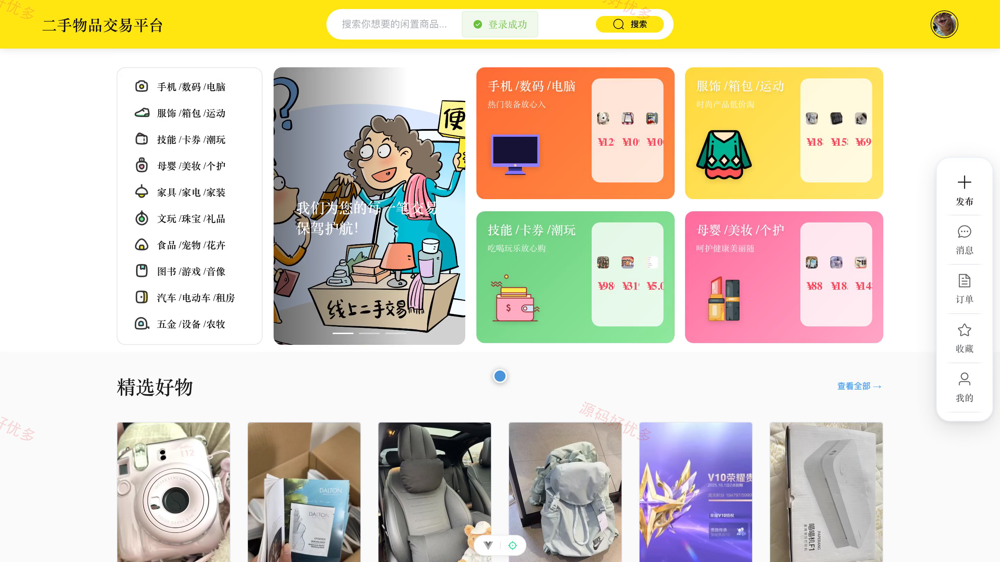
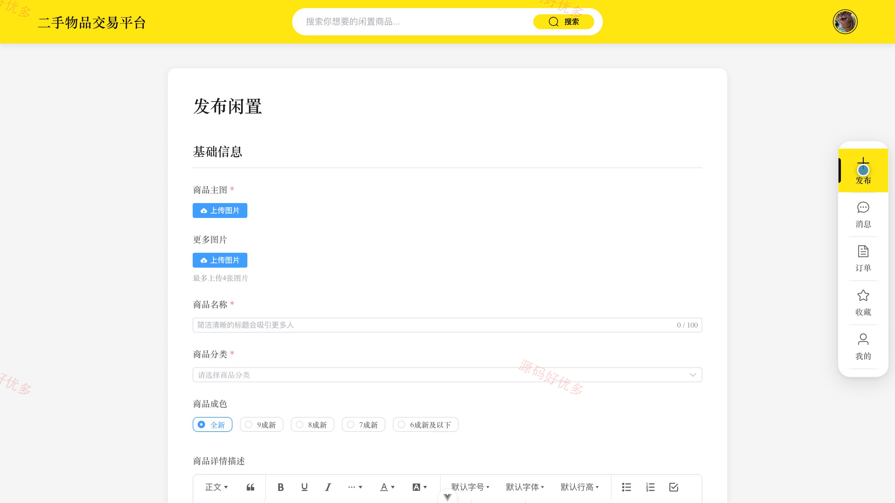
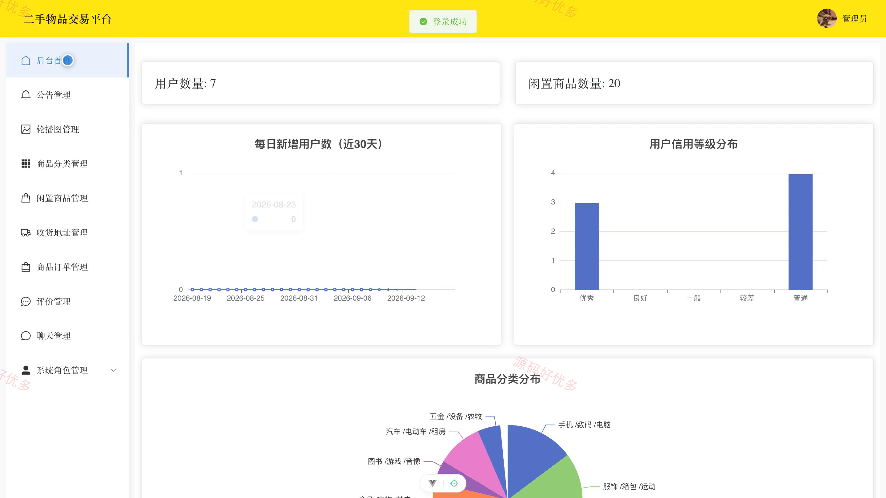
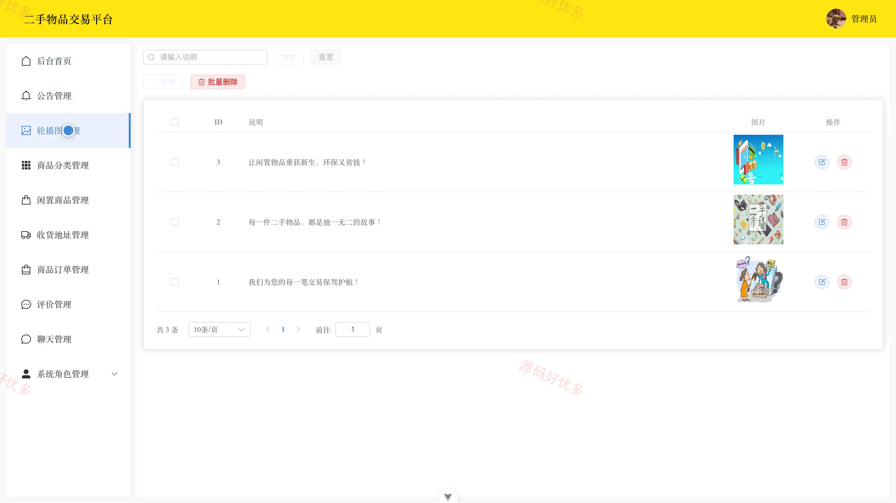
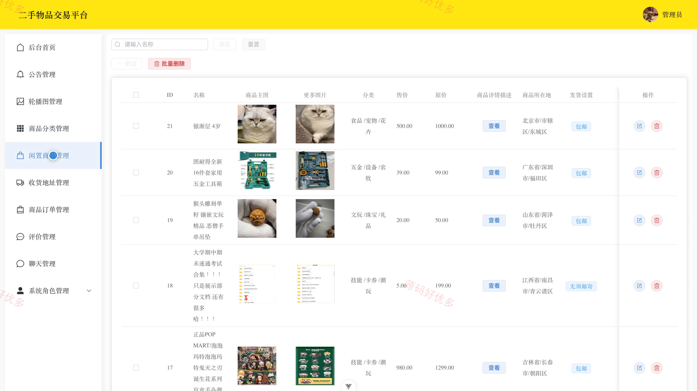

## 源码问题查看主页咨询

### 一、关键词
二手物品交易、闲置交易、跳蚤市场、旧物交换、闲置商品买卖

### 二、作品包含
源码+数据库+万字设计文档+PPT+全套环境和工具资源+本地部署教程

### 三、项目技术
前端技术： Html、Css、Js、Vue3.5、Element-Plus
后端技术：Python、Django

### 四、运行环境要求
开发工具：PyCharm + VSCODE

数据库：MySQL5.7+（共10张表）

数据库管理工具：Navicat10以上版本

环境配置软件： Python3.9+

前端Nodejs：16+

浏览器：谷歌浏览器

### 五、项目介绍
项目编号：bs001C

本平台面向用户和管理员，覆盖闲置商品发布与检索、收藏、下单支付、收发货、交易评价、在线聊天以及后台分类、公告、轮播图和账户管理等业务。

角色：用户、管理员

用户功能：闲置商品浏览与搜索、闲置商品发布与维护、商品收藏、下单支付与订单处理、收货地址管理、买卖双方评价、在线聊天、个人信息与信用记录。

管理员功能：运营数据统计、用户与管理员管理、闲置商品与分类管理、订单与评价管理、收货地址管理、收藏记录管理、聊天记录管理、公告与轮播图管理。

### 六、运行截图

